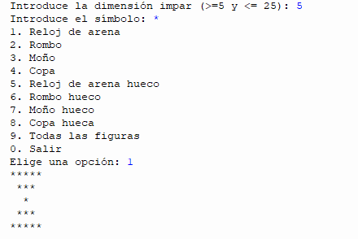

# Programación 1
Intentaré mantener actualizados los programas y cosas que haga aquí
## | Programa | Función |
| --- | --- |
| `Blackjack/blackjack.py` | Juego de blackjack |
| `CurpClave/CURPClave.psc` | Pseudocódigo que proporciona tu CURP |
| `OpRescate/OpRescate.psc` | Calcula si un alumno tendrá posibilidades de ganar |
| `Serpiente/serpiente.py` | Juego básico de la serpiente |
| `GenioYFigura/GenioYFigura.py` | Permite dibujar figuras con símbolos a elegir |
## Requisitos
Tener python 3 instalado
## Cómo ejecutar los programas
Descargar el archivo y ejecutarlo con tu terminal
## Ejemplo de funcionamiento
## Autor
Lizarraga Jimenez Ossiel Emiliano
## Ejecución del programa
### Genio Y Figura
Este programa permite dibujar figuras
**Requisitos:**
- Tener instalado Python 3.
**Ubicación:** `GenioyFigura/GenioYFigura.py`
**Para ejecutarlo:**
```bash
python3 GenioyFigura/GenioYFigura.py
```
## Ejemplo de funcionamiento
Al ejecutar `GenioYFigura.py`, el programa solicita un número impar, el símbolo a utilizar y la figura a dibujar
**Ejemplo de entrada y salida:**
```text
Introduce la dimensión impar (>=5 y <= 25): 5
Introduce el símbolo: *
1. Reloj de arena
2. Rombo
3. Moño
4. Copa
5. Reloj de arena hueco
6. Rombo hueco
7. Moño hueco
8. Copa hueca
9. Todas las figuras
0. Salir
Elige una opción: 1
*****
 *** 
  *  
 *** 
*****
```
